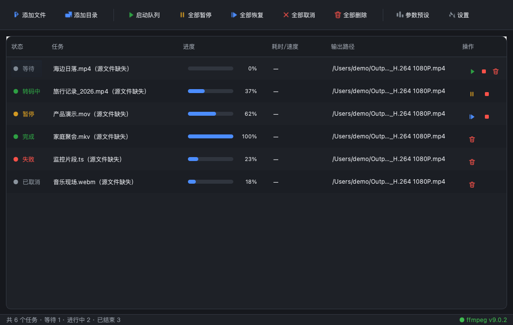
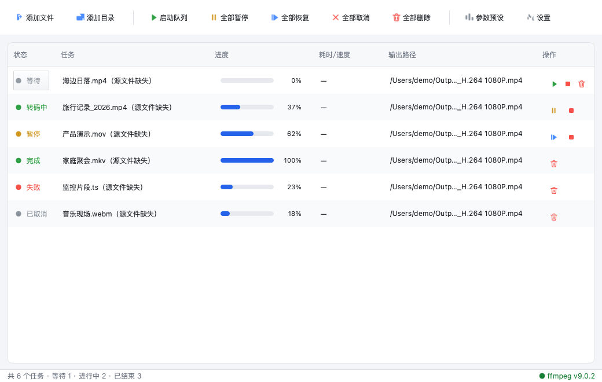
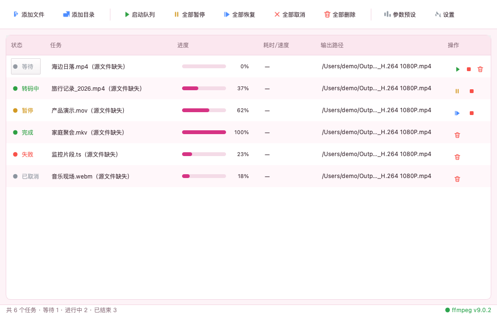
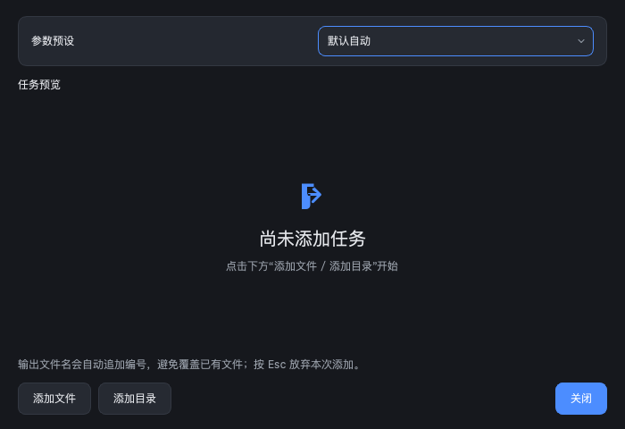
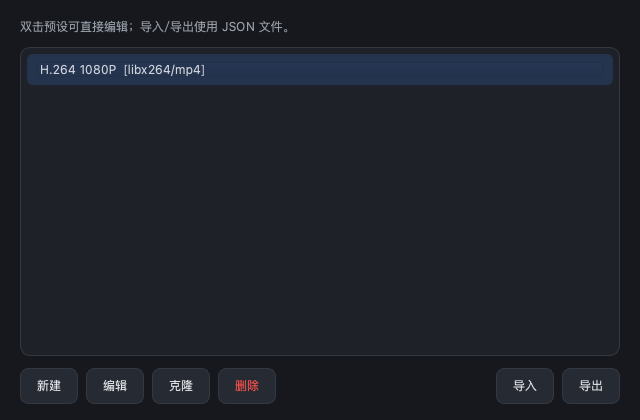
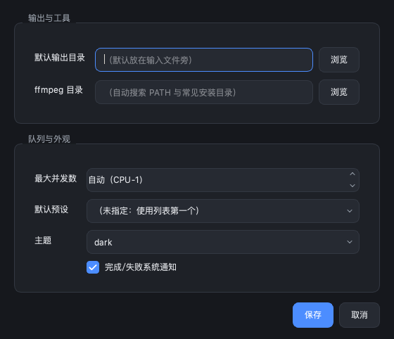
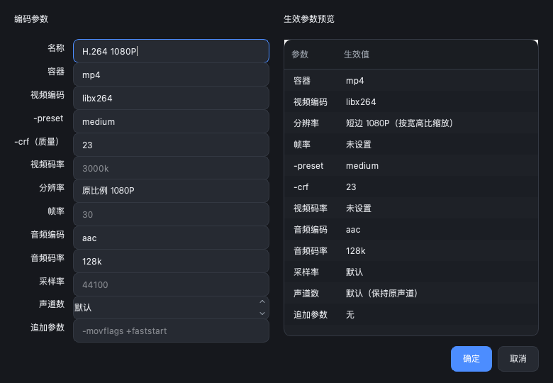
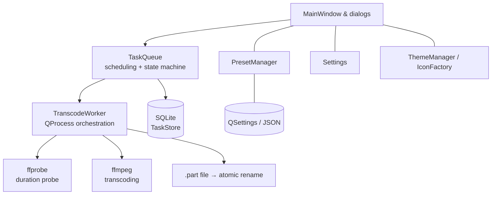

# QEncoder

**A Qt 6 / C++17 batch video transcoding client for macOS — a friendly GUI over `ffmpeg`.**

[](https://github.com/clarkhjc/qencoder/actions/workflows/build.yml)
[](LICENSE)


QEncoder turns repetitive `ffmpeg` command lines into a desktop workflow: batch
import, reusable presets, a concurrent task queue with pause/resume/cancel,
real-time progress, safe atomic output files, and SQLite-backed task recovery
across restarts.

<br>



## Features

### Batch import
- Add multiple files or recursively scan folders for media files
- Supports 20+ common video/audio extensions
- Preview tasks before enqueueing
- Automatic output naming with collision-safe suffixes (`_1`, `_2`, ...)
- Sanitized preset names and configurable default output directory

### Presets
- Create, edit, clone, delete, import, and export presets as JSON
- Live "effective parameters" preview while editing
- Stream copy support (`copy` / empty codec)
- Aspect-ratio-preserving `原比例 1080P` scaling
- Resolution format validation
- Codec availability validation against `ffmpeg -encoders`

### Task queue
- Configurable concurrency (defaults to `CPU-1`)
- Queue-wide and per-task: start, pause, resume, stop, remove, clear all
- State machine: `Waiting → Running → Paused → Running → Done/Failed/Cancelled`
- Terminal-state protection: late worker callbacks can never overwrite a user cancellation
- Graceful cancellation: `SIGTERM`, then `SIGKILL` after a timeout
- Pause/resume via `SIGSTOP`/`SIGCONT` on macOS and Linux

### Transcoding
- Video/audio codec, `-preset`, CRF, bitrate, resolution, FPS, sample rate, channels
- Custom extra arguments
- Output written to a `.part.<ext>` file, then atomically renamed on success
- Failed or cancelled jobs clean up their temporary output
- Existing output files are never overwritten accidentally

### Persistence
- Task queue stored in SQLite via Qt Sql
- Resume the previous task list after restarting the app
- Order-preserving UPSERT; progress persisted roughly every 10%
- Interrupted `Running`/`Paused` tasks are re-queued as `Waiting` with progress 0
- Graceful fallback to in-memory operation if the database is unavailable

### Environment & settings
- Automatic `ffmpeg`/`ffprobe` discovery:
  settings directory → env var → app directory → `PATH` → Homebrew/MacPorts paths
- Startup warning and status-bar indicator when ffmpeg is missing
- Settings: output directory, ffmpeg directory, concurrency, default preset,
  theme, system notifications

### UI
- Three complete QSS themes: dark, light, pink
- Semantic SVG icon tinting at runtime
- Empty-state page, status summary, contextual toolbar enable/disable
- Compact action buttons and tooltips
- macOS `.app` bundle with custom icon and bundled themes

## Screenshots

<p align="center">
  
  
  
</p>

<details>
<summary>More screenshots</summary>

| Add tasks | Preset manager |
| --- | --- |
|  |  |

| Settings | Preset editor |
| --- | --- |
|  |  |

</details>

## Architecture



Key ideas:
- **Event-driven, non-blocking UI**: ffprobe and ffmpeg are asynchronous
  `QProcess` instances; no `waitForFinished()` on the UI path.
- **Process state machine**: pause, resume, cancel, failure, and app shutdown
  all have explicit handling.
- **Safe output**: temporary files plus same-directory rename avoid exposing
  partial videos at the final path.
- **Optional persistence**: the database is an enhancement; the queue still
  works in memory if SQLite is unavailable.

## Requirements

- macOS 12 or newer
- Qt 6.8+ (developed with Qt 6.12; CI builds against Homebrew Qt on macOS)
- CMake 3.16+
- C++17 compiler (Apple Clang)
- `ffmpeg` and `ffprobe` available in `PATH` or configured in Settings

The smoke tests generate a small test clip, so the local ffmpeg build should
include `libx264`.

## Build & Run

```bash
brew install qt ffmpeg

cmake -S . -B build -DCMAKE_PREFIX_PATH="$(brew --prefix qt)"
cmake --build build --parallel

ctest --test-dir build --output-on-failure

open build/QEncoder.app
```

If CMake cannot find Qt, pass the Qt prefix explicitly:

```bash
cmake -S . -B build -DCMAKE_PREFIX_PATH=/path/to/Qt/6.8.3/macos
```

Useful options:

```bash
# Plain executable instead of a .app bundle
cmake -S . -B build -DQENCODER_MACOS_BUNDLE=OFF

# Skip building tests
cmake -S . -B build -DQENCODER_BUILD_TESTS=OFF
```

## Tests

```bash
ctest --test-dir build --output-on-failure
```

- `smoke_test` — 40+ assertions covering:
  - argument construction (codec / copy / aspect-preserving scaling)
  - ffmpeg progress parsing
  - queue concurrency, cancellation, removal, and persistence
  - fake-ffmpeg tests for cancellation race conditions
  - end-to-end transcode with a generated test clip
- `gui_check` — runs with `QT_QPA_PLATFORM=offscreen`, verifies toolbar
  state/screenshots, and simulates a restart with 6 restored tasks.

The project has also been checked with `-Wall -Wextra` and ASan/UBSan.

## Packaging

Build a self-contained DMG with Qt frameworks bundled:

```bash
cmake --build build --target deploy_macos
# -> build/QEncoder.dmg
```

Optional signing and notarization:

```bash
xcrun notarytool store-credentials qencoder-notary \
  --apple-id "you@example.com" \
  --team-id "TEAMID" \
  --password "app-specific-password"

cmake -S . -B build \
  -DQENCODER_MACOS_SIGN_IDENTITY="Developer ID Application: Your Name (TEAMID)" \
  -DQENCODER_NOTARY_PROFILE="qencoder-notary"

cmake --build build --target notarize_macos
```

Signing identities and notarization credentials are passed through local CMake
cache variables and are never committed.

## Data & Configuration

- Task database: `QStandardPaths::AppDataLocation`, normally under
  `~/Library/Application Support/QEncoder/.../tasks.db`
- Override the database path:

  ```bash
  QENCODER_TASK_DB=/path/to/tasks.db ./QEncoder.app/Contents/MacOS/QEncoder
  ```

- Settings and presets are stored with `QSettings`
- Presets can be imported/exported as JSON from the preset manager

Other environment variables:

| Variable | Purpose |
| --- | --- |
| `QENCODER_TASK_DB` | Override the SQLite task database path |
| `QENCODER_FFMPEG_DIR` | Directory containing `ffmpeg`/`ffprobe` |
| `QENCODER_THEMES_DIR` | Directory containing the `.qss` theme files |

## Project Layout

```
src/
  core/        TaskQueue, TranscodeWorker, TaskStore, MediaProbe, ...
  presets/     PresetManager
  settings/    Settings, ThemeManager
  ui/          MainWindow, dialogs, IconFactory, .ui forms
tests/         smoke_test, gui_check
themes/        dark.qss, light.qss, pink.qss
icons/         SVG icons, .icns app icon
cmake/         Info.plist template
```

## Design Notes

A few implementation details that are easy to miss:

- ffmpeg reports both `out_time_us` and `out_time_ms` in **microseconds**;
  the parser handles both and uses a line buffer to avoid chunk-boundary bugs.
- The queue prefers the user's cancellation intent: when a task is already
  `Cancelled`, a late `Failed`/`Done` callback cannot overwrite it.
- Output files are written as `.part.<extension>` so ffmpeg still has the
  correct extension to infer the muxer; successful jobs are renamed into place.
- Progress writes to SQLite are throttled to roughly 10% steps to avoid
  excessive disk I/O while keeping restarts reasonably accurate.
- The CMake build compiles the shared sources exactly once via an `OBJECT`
  library, then links them into the app and both test executables.

## Limitations & Roadmap

- Interrupted encodes restart from the beginning; there is no segment-based
  resume yet.
- Workers are event-driven on the GUI thread. Very large queues would benefit
  from a worker thread pool.
- The task table uses `QTableWidget`; a `QAbstractTableModel` view would scale
  better to thousands of rows.
- Pause is only implemented on Unix-like systems; on other platforms the app
  reports that pause is unsupported instead of pretending it worked.
- Distribution requires local signing/notarization credentials.

## License

[MIT](LICENSE)

---

Built with [Qt](https://www.qt.io/) and [FFmpeg](https://ffmpeg.org/).
Not affiliated with either project.
